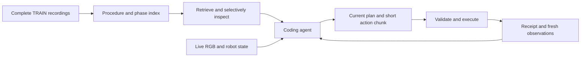

# How LinkMind works

LinkMind is a studio for embodying coding agents. It connects a general coding agent to robot observations, programmable controls, reusable task tools and recorded interaction experience through MCP. The agent uses those resources to write actions for the scene in front of it and revises its decisions after inspecting execution feedback.

## The design question

The value of a tool or harness depends on the model and the task. A procedure that helps one model may become unnecessary for a stronger model; a task with harder contact or coordination may still need additional support. We call the possible decline in a fixed support configuration's incremental value **Embodied Infrastructure Half-Life**.

The quantity of interest is the performance gain over the same model using a basic robot interface: `gain(model, support, tasks) = performance(model, support, tasks) - performance(model, basic_interface, tasks)`. To compare that gain across models, keep the scenes, budgets and both interfaces fixed. A change in model ranking, or a successful simplification on two scenes, does not establish a universal decay law. The [local model study](local-results.md) illustrates why support should be evaluated with its model and task.

## Interaction Experience Harness

The experience bank retains complete TRAIN recordings outside the agent's active context. A descriptive index divides each recording into contiguous interaction phases. Each phase links its local objective, preceding situation, demonstrated operation and described effect to a source episode and exact frame interval.

The agent first retrieves a compact procedure or relevant interaction. Task-filtered lexical retrieval considers the goal and scene, with arm and object information when supplied. The agent can then expand selected phases without loading every image or action from every demonstration. A reference window can expose measured endpoint states, motion summaries, gripper events, original images and optional numerical actions. Window boundaries, phase-level effects and commanded events remain distinct: a gripper-close command alone is not evidence of a successful grasp.

The released default workflow is:

1. Observe live RGB views and robot state.
2. Retrieve relevant procedures or interaction references.
3. Record a scene-specific plan and cite the experience actually adopted.
4. Generate a bounded action chunk, with its local objective and expected effect.
5. Inspect the execution receipt and fresh observations, then continue or revise.

The plan belongs to the current episode. The agent may combine, skip or reorder demonstrated operations; the experience index does not schedule execution or enforce stage admission. Recorded coordinates and outcomes are historical evidence, not current scene targets or proof that an action succeeded.

## Robot interfaces

The adapter declares frames, units, timing and gripper conventions. The delta-control path uses short segments of at most 24 rows at 25 Hz. Task-specific extensions include planar measurements for Push-T, RGB geometry, persistent Python cells and reference/motion tools for selected tasks. They are enabled by task and retain their original contracts. Several task adapters include a 0.25-radian joint-continuity check. Invalid commands return explicit errors; receipts distinguish accepted, rejected and truncated execution.

Simulation scoring is independent of the agent's final message. The agent receives public observations and controls, not hidden evaluator object poses or success logic. Complete source-linked demonstrations support inspection and adaptation; the default workflow does not blindly replay an old trajectory.

## What this release establishes

The code integrates the evaluated task implementations and preserves default prompt/tool contracts. The optional `--push-simplification` profiles expose successively smaller interfaces, ending with observation, planar measurement and action execution. Their two-scene-per-profile pilot is reported separately; the default remains `baseline`.

The [paper main table](main-table.md) preserves the paper's comparison convention and author-supplied values. The [local evidence table](local-results.md) provides the independently archived per-attempt record. Integration tests do not create a new native success rate, and the existing studies do not establish single-tool causal gains, cross-robot generalization or total cost superiority. New runs should freeze their own code, models, demonstrations and protocols.
